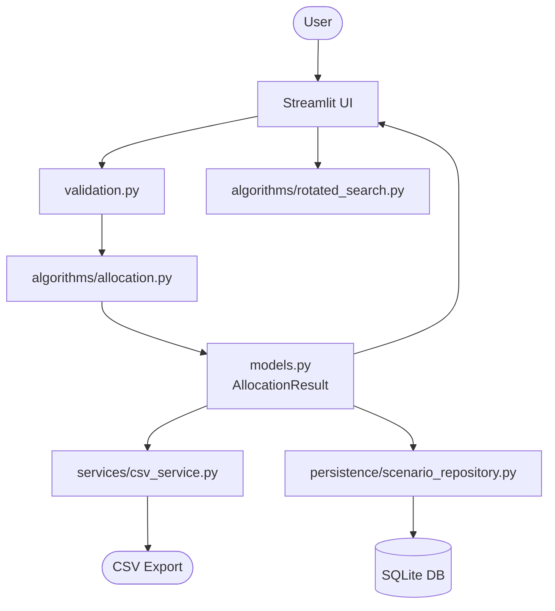

# LoadLens — Explainable Workload Allocation & Capacity Planning

> Given an ordered sequence of tasks and a number of workers, LoadLens finds the optimal contiguous partition that **minimises the maximum workload** assigned to any single worker — using binary search on the answer paired with a greedy feasibility check.

---

## The Problem

You have `n` ordered tasks, each requiring a positive integer amount of work. You have `k` workers. Each worker must take a non-empty, **contiguous** block of consecutive tasks in the original order. How do you divide the tasks so the busiest worker has the **least possible workload**?

**Example:**
- Tasks: J1=7, J2=2, J3=5, J4=10, J5=8 (total = 32)
- Workers: 3
- Optimal result: W1=[J1,J2,J3]=**14**, W2=[J4]=10, W3=[J5]=8 → max = **14**

The brute-force approach tries C(n-1, k-1) split combinations — impossibly large for real inputs. LoadLens solves this in **O(n log R)** time.

---

## Features

| Feature | Description |
|---------|-------------|
| 🔭 **Planner** | Edit tasks, upload CSV, select workers, run optimization, download results |
| 🧪 **Algorithm Lab** | Step-by-step binary-search trace, plus rotated sorted-array search demo |
| 📂 **Scenario History** | Save, browse, restore, and delete local SQLite scenarios |
| ℹ️ **About** | Algorithm explanation, model assumptions, CSV schema, deployment guide |

---

## Model Assumptions

- Tasks are **indivisible** — each task goes to exactly one worker.
- Task **order is fixed** — never reordered before allocation.
- Workers receive **contiguous blocks** only.
- All workers have **equal speed** — durations are comparable integers.
- Objective is to **minimise the maximum workload** (makespan when parallel).
- Does **not** model: travel time, precedence, worker skills, or non-integer durations.

---

## Algorithm — Binary Search on the Answer

### Why it works

The key insight: the feasibility predicate `required_workers(C) ≤ k` is **monotonically non-decreasing** as capacity C increases. This is because all task durations are positive integers — increasing C can only merge groups, never force a new split. Binary search on a monotone predicate always finds the exact optimum.

### Steps

1. **Lower bound:** `max(max_task_duration, ⌈total_duration / k⌉)`
2. **Upper bound:** `sum(all durations)`
3. **Feasibility check (O(n)):** Greedy left-to-right scan counting groups needed under capacity C.
4. **Binary search (O(log R)):** Find the smallest feasible C.
5. **Reconstruction (O(n)):** Replay greedy to produce exactly k non-empty contiguous groups.

**Total complexity:** O(n log R) time, O(n) space  
where R = sum(d) − lower_bound + 1

See [`docs/ALGORITHM_WALKTHROUGH.md`](docs/ALGORITHM_WALKTHROUGH.md) for pseudocode and a full worked trace.

---

## Architecture

```
loadlens/
├── models.py          # Domain types: Task, WorkerGroup, AllocationResult, …
├── validation.py      # Input validation (domain boundary)
├── algorithms/
│   ├── allocation.py  # Binary-search solver (pure Python, no UI/DB)
│   └── rotated_search.py  # Rotated array search (separate demo)
├── services/
│   └── csv_service.py # Safe CSV import/export
├── persistence/
│   └── scenario_repository.py  # SQLite CRUD (stdlib sqlite3)
└── ui/
    ├── planner_page.py       # Planner UI
    ├── algorithm_lab_page.py # Algorithm Lab UI
    ├── history_page.py       # Scenario History UI
    └── about_page.py         # About & Help UI
streamlit_app.py  # Entry point and navigation
```

**Data flow:** UI → Validation → Algorithm → Models → UI / CSV / SQLite

---

## Architecture Diagram



---

## Prerequisites

- **Python 3.12** (tested; 3.10+ should work)
- **Windows PowerShell** (commands below)
- No external services, API keys, or network access required after install

---

## Setup & Run (Windows PowerShell)

```powershell
# 1. Clone or navigate to the project directory
cd d:\python-projects\loadlens

# 2. Create and activate a virtual environment
python -m venv .venv
.venv\Scripts\Activate.ps1

# 3. Install dependencies
pip install -r requirements.txt

# 4. Launch the app
streamlit run streamlit_app.py

# 5. Run tests
python -m pytest -q

# 6. Compile-check all modules
python -m compileall loadlens streamlit_app.py -q
```

The app opens at `http://localhost:8501` in your browser.

---

## CSV Input Schema

**File:** `samples/tasks_example.csv`

```csv
task_name,duration
Research & Requirements,7
Database Schema Design,2
Backend API Development,5
Frontend Implementation,10
Integration Testing,8
```

- **Headers:** `task_name,duration` (case-insensitive; BOM-safe for Excel exports)
- **task_name:** Non-empty string; Unicode supported
- **duration:** Positive integer; no decimals, negatives, or blanks
- **Max file size:** 5 MB
- **Max rows:** 10,000 tasks

**Export columns:** `worker_id, worker_workload_{unit}, task_order, task_name, task_duration_{unit}, optimal_capacity_{unit}`

---

## Local Scenario History (SQLite)

Saved scenarios are stored in:
- **Windows:** `%LOCALAPPDATA%\loadlens\loadlens_scenarios.db`
- **Linux/Mac:** `~/.local/share/loadlens/loadlens_scenarios.db`

**Important:** On hosted platforms (Streamlit Community Cloud, Heroku, etc.), the filesystem is typically ephemeral — scenario history **may not persist across app restarts**. For durable multi-user persistence, configure a hosted database service. The local SQLite implementation is local-first and not designed for cloud persistence.

---

## Deployment (Streamlit Community Cloud)

1. Push this repository to GitHub (ensure `.db` files are in `.gitignore` ✅).
2. Go to [share.streamlit.io](https://share.streamlit.io) and connect the repo.
3. **Main file path:** `streamlit_app.py`
4. **Dependencies:** `requirements.txt` (automatically detected)
5. The app runs without any secrets or API keys.

*Note: No deployment has been verified by the author. The above steps reflect Streamlit Community Cloud's documented procedure as of October 2024.*

---

## Testing

```powershell
# Run all tests
python -m pytest -q

# Run with verbose output
python -m pytest -v

# Run a specific file
python -m pytest tests/test_allocation.py -v
```

**Test files:**

| File | Description |
|------|-------------|
| `test_allocation.py` | Core solver: feasibility, optimizer, reconstruction, trace |
| `test_allocation_reference.py` | Independent brute-force cross-validation |
| `test_rotated_search.py` | Rotated array search: all edge cases |
| `test_csv_service.py` | CSV import/export: validation, escaping, round-trips |
| `test_scenario_repository.py` | SQLite CRUD: save, list, get, delete, error handling |

---

## Limitations & Next Steps

**Current limitations:**
- Task durations must be positive integers (no fractional durations).
- Workers are assumed to operate at equal speed.
- No precedence constraints or dependency graphs.
- SQLite history is not suitable for multi-user hosted deployments without modification.
- No authentication, access control, or multi-tenancy.

**Possible next steps:**
- Add fractional duration support with scaled integer conversion.
- Support precedence-constrained scheduling (a much harder problem class).
- Replace SQLite with a hosted database for cloud deployments.
- Add Gantt chart visualization.
- Add benchmark comparison mode in the Algorithm Lab.

---

## License

This project is provided as-is for educational and portfolio purposes. No warranty is expressed or implied.
